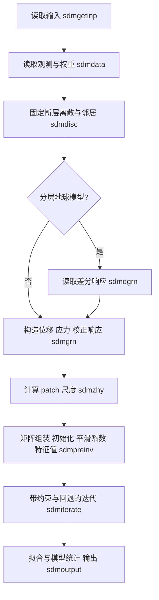

# SDM2025 反演数学表达与求解过程：基于源码的推导

本文依据本仓库 `SDM2025/SourceCode/` 的当前实现，说明多数据集、多断层段情况下的静态滑移反演。核对日期为 2026-10-12，仓库基准提交为 `cb2f08c`。本文是源码分析和数学说明，不修改科学内核、输入参数或已有结果；不将 `Old/sdm2013/` 的实现与当前版本混用。

全文按三章组织：第 0 章补充矩阵与线性代数基础，重点讲解分块矩阵运算；第 1 章建立 SDM 的观测、权重、参数变换、平滑约束和目标函数；第 2 章按照源码顺序推导矩阵组装、初始化、步长、约束处理和停止条件。

建议先阅读 0.4—0.7 节掌握分块运算，再按 0.9 节理解最小二乘与正规系统，随后将这些规则应用到第 1 章的具体矩阵。第 0 章的例子用于解释代数规则，不代替 SDM 的权重、单位或科学约束。

**表述约定：**“源码实现”指当前程序实际执行的运算；“数学解释”指由这些运算得到的等价公式；“理论条件”不表示当前程序已经检查或满足这些条件。特别地，`sdmproj` 下文记为约束处理映射 $\Pi_{\mathrm{code}}$，不预先假定它是严格的欧氏投影。

## 第 0 章：必要的线性代数与分块矩阵运算

### 0.1 标量、向量、矩阵与维数

标量是一个数，列向量是一列数，矩阵是按行和列组织的数。本文默认向量均为列向量：

$$
x=\begin{bmatrix}x_1\\\vdots\\x_n\end{bmatrix}
\in\mathbb R^n,
\qquad
A=\begin{bmatrix}
a_{11}&\cdots&a_{1n}\\
\vdots&\ddots&\vdots\\
a_{m1}&\cdots&a_{mn}
\end{bmatrix}
\in\mathbb R^{m\times n}.
$$

$\mathbb R^{m\times n}$ 表示矩阵有 $m$ 行、$n$ 列；$a_{ij}$ 是第 $i$ 行、第 $j$ 列的一个标量。$A_{:j}$ 表示第 $j$ 列向量，$A_{i:}$ 表示第 $i$ 行。冒号仅是索引记号，不表示求和。

本章先用 $m,n$ 表示通用的行数和列数，用 $x$ 表示通用未知向量；进入 SDM 后，观测矩阵 $A$ 的维数为 $M\times D$，未知向量由 $q$ 表示，$D=2N+P$。第 1.1 节给出全部科学符号与源码数组的对应关系。

| 运算 | 输入维数 | 输出维数 |
| --- | --- | --- |
| $Ax$ | $A:m\times n$，$x:n\times1$ | $m\times1$ |
| $AB$ | $A:m\times n$，$B:n\times p$ | $m\times p$ |
| $x^{\mathsf T}y$ | $x,y:n\times1$ | 标量 |
| $xy^{\mathsf T}$ | $x:m\times1$，$y:n\times1$ | $m\times n$ |
| $A^{\mathsf T}A$ | $A:m\times n$ | $n\times n$ |
| $A^{\mathsf T}y$ | $A:m\times n$，$y:m\times1$ | $n\times1$ |

维数检查是推导的第一步。例如 $A^{\mathsf T}A$ 作用于参数空间，$AA^{\mathsf T}$ 作用于观测空间；它们通常维数不同，不能互换。

### 0.2 矩阵—向量乘法：按行、按列两种理解

矩阵—向量乘法 $y=Ax$ 的第 $i$ 个元素是

$$
y_i=\sum_{j=1}^{n}a_{ij}x_j.
\tag{0.1}
$$

**按行理解：**第 $i$ 行给出一条观测方程，计算全部未知量对该条观测的贡献之和。

**按列理解：**整个预测向量是各列响应的线性组合：

$$
Ax=x_1A_{:1}+x_2A_{:2}+\cdots+x_nA_{:n}.
\tag{0.2}
$$

在滑移正演中，一列对应一个 patch 的一个单位滑移分量产生的全部观测响应；该列乘相应滑移量后，再与其他列相加。SDM 的第 1.2 节就是将这一规则应用于位移 Green's functions 和校正响应。

这也解释了为何一般不能只看一个 patch 对一个测点的响应判断该 patch 是否可被独立约束：若两列几乎相同，两个参数的不同组合可以产生很相近的总预测。

### 0.3 矩阵乘法、转置与运算次序

若 $A\in\mathbb R^{m\times n}$、$B\in\mathbb R^{n\times p}$，则

$$
(AB)_{i\ell}=\sum_{j=1}^{n}a_{ij}b_{j\ell}.
\tag{0.3}
$$

内侧维数必须相同。矩阵乘法满足结合律 $(AB)x=A(Bx)$，一般不满足交换律；$AB$ 与 $BA$ 可能数值不同，甚至只有一个有定义。

转置把行变成列：

$$
(A^{\mathsf T})_{ji}=a_{ij},
\qquad
(AB)^{\mathsf T}=B^{\mathsf T}A^{\mathsf T},
\qquad
(A+B)^{\mathsf T}=A^{\mathsf T}+B^{\mathsf T}.
\tag{0.4}
$$

乘积转置必须倒转顺序。例如

$$
(WA)^{\mathsf T}(WA)
=A^{\mathsf T}W^{\mathsf T}WA,
$$

不能写成 $W^{\mathsf T}A^{\mathsf T}WA$。后文加权正规矩阵和参数尺度变换都使用这条规则。

### 0.4 矩阵分块与块乘法规则

#### 0.4.1 分块是对已有行列的分组

将 $A$ 的行分成两组、列分成两组：

$$
A=\begin{bmatrix}A_{11}&A_{12}\\A_{21}&A_{22}\end{bmatrix},
\qquad x=\begin{bmatrix}x_1\\x_2\end{bmatrix}.
$$

若两组行数为 $m_1,m_2$，两组列数为 $n_1,n_2$，则

| 块 | 维数 |
| --- | --- |
| $A_{11}$ | $m_1\times n_1$ |
| $A_{12}$ | $m_1\times n_2$ |
| $A_{21}$ | $m_2\times n_1$ |
| $A_{22}$ | $m_2\times n_2$ |
| $x_1,x_2$ | 分别为 $n_1\times1$、$n_2\times1$ |

$A_{12}$ 在这里是整个子矩阵，不是单个元素 $a_{12}$。分块不会改变矩阵中的任何数，也不会自动使各块独立。

#### 0.4.2 分块矩阵乘分块向量

$$
Ax=
\begin{bmatrix}
A_{11}x_1+A_{12}x_2\\
A_{21}x_1+A_{22}x_2
\end{bmatrix}.
\tag{0.5}
$$

每一块行都接收所有块列的贡献：第一组预测由 $x_1,x_2$ 共同产生，第二组也一样。将某个非对角块丢掉，通常是在改变正演模型。

一般地，若 $A_{ij}$ 的维数为 $m_i\times n_j$，$x_j\in\mathbb R^{n_j}$，则

$$
(Ax)_i=\sum_jA_{ij}x_j\in\mathbb R^{m_i}.
\tag{0.6}
$$

#### 0.4.3 两个分块矩阵相乘

若 $B$ 的块行划分与 $A$ 的块列划分一致，

$$
A=\begin{bmatrix}A_{11}&A_{12}\\A_{21}&A_{22}\end{bmatrix},
\qquad
B=\begin{bmatrix}B_{11}&B_{12}\\B_{21}&B_{22}\end{bmatrix},
$$

则

$$
AB=\begin{bmatrix}
A_{11}B_{11}+A_{12}B_{21}&A_{11}B_{12}+A_{12}B_{22}\\
A_{21}B_{11}+A_{22}B_{21}&A_{21}B_{12}+A_{22}B_{22}
\end{bmatrix}.
\tag{0.7}
$$

规则与普通乘法相同：沿左矩阵的块行和右矩阵的块列相乘，再对中间块索引求和。一般式为

$$
(AB)_{i\ell}=\sum_jA_{ij}B_{j\ell}.
\tag{0.8}
$$

例如 $A_{ij}:m_i\times n_j$、$B_{j\ell}:n_j\times p_\ell$，每个乘积都是 $m_i\times p_\ell$，所以可以相加。若两个矩阵的分块切分不一致，应先重新划分，而不是直接套块乘法。

### 0.5 一个具有不同块大小的数值例子

取

$$
A=\begin{bmatrix}1&2&3\\4&5&6\\7&8&9\end{bmatrix},
\qquad x=\begin{bmatrix}1\\2\\3\end{bmatrix}.
$$

将第一行作为一组、后两行作为一组；前两列作为一组、最后一列作为一组。此时

$$
\begin{aligned}
A_{11}&=\begin{bmatrix}1&2\end{bmatrix},
& A_{12}&=\begin{bmatrix}3\end{bmatrix},\\
A_{21}&=\begin{bmatrix}4&5\\7&8\end{bmatrix},
& A_{22}&=\begin{bmatrix}6\\9\end{bmatrix},\\
x_1&=\begin{bmatrix}1\\2\end{bmatrix},
& x_2&=\begin{bmatrix}3\end{bmatrix}.
\end{aligned}
$$

按块计算：

$$
A_{11}x_1+A_{12}x_2=5+9=14,
$$

$$
A_{21}x_1+A_{22}x_2
=\begin{bmatrix}14\\23\end{bmatrix}
+\begin{bmatrix}18\\27\end{bmatrix}
=\begin{bmatrix}32\\50\end{bmatrix}.
$$

因此 $Ax=[14,32,50]^{\mathsf T}$，与直接使用完整矩阵计算相同。块不必是方阵，也不必具有相同大小；需要匹配的是每个乘积的内侧维数和每个和项的外侧维数。

### 0.6 分块转置、Gram 矩阵与数据右端项

#### 0.6.1 分块转置

转置不仅转置各块，还交换块的位置：

$$
A^{\mathsf T}=
\begin{bmatrix}
A_{11}^{\mathsf T}&A_{21}^{\mathsf T}\\
A_{12}^{\mathsf T}&A_{22}^{\mathsf T}
\end{bmatrix}.
\tag{0.9}
$$

若 $A_{12}:m_1\times n_2$，其转置是 $n_2\times m_1$，并位于转置矩阵的第二块行、第一块列。

#### 0.6.2 分块 Gram 矩阵

将式（0.9）乘原矩阵，得到

$$
A^{\mathsf T}A=
\begin{bmatrix}
A_{11}^{\mathsf T}A_{11}+A_{21}^{\mathsf T}A_{21}
&A_{11}^{\mathsf T}A_{12}+A_{21}^{\mathsf T}A_{22}\\
A_{12}^{\mathsf T}A_{11}+A_{22}^{\mathsf T}A_{21}
&A_{12}^{\mathsf T}A_{12}+A_{22}^{\mathsf T}A_{22}
\end{bmatrix}.
\tag{0.10}
$$

这里第二参数块与第一参数块之间的耦合来自同一观测行组内的响应内积。矩阵是对称的：第 $(2,1)$ 块等于第 $(1,2)$ 块的转置。

一般地，将观测按数据集 $k$、未知量按参数组 $j$ 分块，则

$$
(A^{\mathsf T}A)_{j\ell}
=\sum_kA_{kj}^{\mathsf T}A_{k\ell}.
\tag{0.11}
$$

式（0.11）对**同一数据集内两组参数的响应**求内积，再对数据集求和。由于数据集是按行堆叠的，这里没有 $k\ne h$ 的 $A_{kj}^{\mathsf T}A_{h\ell}$ 交叉项；不同数据集的观测数甚至可以不同。

它也不意味着不同 segment 可以独立求解：只要同一数据集同时接收两个 segment 的变形，$j\ne\ell$ 的系统块通常非零。

#### 0.6.3 右端项的分块

若 $y=[y_1^{\mathsf T},y_2^{\mathsf T}]^{\mathsf T}$，则

$$
A^{\mathsf T}y=
\begin{bmatrix}
A_{11}^{\mathsf T}y_1+A_{21}^{\mathsf T}y_2\\
A_{12}^{\mathsf T}y_1+A_{22}^{\mathsf T}y_2
\end{bmatrix},
$$

一般式为

$$
(A^{\mathsf T}y)_j=\sum_kA_{kj}^{\mathsf T}y_k.
\tag{0.12}
$$

每组参数都从全部观测组获得信息。SDM 中的 $H_{\mathrm{obs}}$ 和 $b$ 分别使用式（0.11）、式（0.12）。

### 0.7 对角矩阵、块对角矩阵与行列尺度变换

对角矩阵只有对角线元素非零：

$$
W=\operatorname{diag}(\gamma_1,\ldots,\gamma_m).
$$

左乘它给矩阵各行乘不同因子，右乘对角矩阵则给各列乘不同因子：

$$
(WA)_{ij}=\gamma_i a_{ij},
\qquad
(AT)_{ij}=a_{ij}t_j,
\quad T=\operatorname{diag}(t_1,\ldots,t_n).
\tag{0.13}
$$

块对角矩阵将这一概念推广到整个子矩阵，例如

$$
W=\begin{bmatrix}W_1&0\\0&W_2\end{bmatrix},
\qquad
WA=\begin{bmatrix}
W_1A_{11}&W_1A_{12}\\
W_2A_{21}&W_2A_{22}
\end{bmatrix}.
\tag{0.14}
$$

这里零块具有与相应位置匹配的行列数。块对角形式表示权重作用时不混合不同观测组，并不表示加权后的正规矩阵按参数分块对角。

加权残差平方为

$$
\|W(Ax-y)\|_2^2
=(Ax-y)^{\mathsf T}\Omega(Ax-y),
\qquad \Omega=W^{\mathsf T}W.
\tag{0.15}
$$

若 $W$ 的对角元素是 $\gamma_i$，目标函数中对应的是 $\omega_i=\gamma_i^2$。因此要给平方残差权重 $\omega_i$，应将矩阵行和观测乘 $\sqrt{\omega_i}$，而不是乘 $\omega_i$。

若 $\Omega=\operatorname{blockdiag}(\Omega_1,\ldots,\Omega_K)$，则加权系统块为

$$
(A^{\mathsf T}\Omega A)_{j\ell}
=\sum_kA_{kj}^{\mathsf T}\Omega_kA_{k\ell},
\qquad
(A^{\mathsf T}\Omega y)_j
=\sum_kA_{kj}^{\mathsf T}\Omega_ky_k.
\tag{0.16}
$$

这一节的 $A,y$ 尚未加权；第 1 章将加权后的矩阵本身命名为 $A$、加权观测命名为 $y$，于是其正规矩阵直接写成 $A^{\mathsf T}A$。两种写法是同一运算的不同阶段，不能在已经加权的 $A$ 上再乘一次同样的 $W$。

对于未知量尺度变换，若物理未知量 $x=Tq$，则正演变为 $ATq$。只要 $T$ 可逆，单独这一变量替换不会改变物理预测；但若同时改动正则化矩阵，所解的物理目标函数可能改变。第 1.4—1.5 节分别追踪这两种作用。

### 0.8 内积、范数、Gram 矩阵与正定性

两个同维实向量的内积和欧氏范数是

$$
x^{\mathsf T}z=\sum_i x_i z_i,
\qquad
\|x\|_2=\sqrt{x^{\mathsf T}x}.
\tag{0.17}
$$

矩阵的 Frobenius 范数是全部元素平方和的平方根：

$$
\|A\|_F^2=\sum_i\sum_j a_{ij}^2
=\sum_j\|A_{:j}\|_2^2
=\operatorname{tr}(A^{\mathsf T}A).
\tag{0.18}
$$

$\operatorname{tr}$ 表示对角元素之和。它与矩阵的谱范数不同，后者是

$$
\|A\|_2=\max_{x\ne0}\frac{\|Ax\|_2}{\|x\|_2}.
$$

第 1.4 节的总体响应尺度使用 $\|A\|_F$；第 2.5 节的步长分母则与最大的谱响应相关。二者不能互换。

Gram 矩阵 $H=A^{\mathsf T}A$ 满足

$$
H_{ij}=A_{:i}^{\mathsf T}A_{:j},
\qquad
x^{\mathsf T}Hx=\|Ax\|_2^2\ge0.
\tag{0.19}
$$

所以它对称半正定。若对任意非零 $x$ 都有 $x^{\mathsf T}Hx>0$，则为正定；对于 Gram 矩阵，这等价于 $A$ 的列线性无关，即满列秩。

若存在非零 $x$ 使 $Ax=0$，则 $x$ 属于零空间：沿这个模型方向变化不会改变预测，Gram 矩阵奇异。加入平滑后是否消除这种方向，要看该方向是否也满足 $Sx=0$，而不是只看平滑因子是否大于零。

### 0.9 最小二乘、增广矩阵、正规方程与梯度

#### 0.9.1 从残差平方到正规方程

设待最小化的误差向量为 $e=Ax-y$，则

$$
\begin{aligned}
\phi(x)&=\|Ax-y\|_2^2\\
&=(Ax-y)^{\mathsf T}(Ax-y)\\
&=x^{\mathsf T}A^{\mathsf T}Ax
-2x^{\mathsf T}A^{\mathsf T}y+y^{\mathsf T}y.
\end{aligned}
\tag{0.20}
$$

这里使用 $(Ax)^{\mathsf T}=x^{\mathsf T}A^{\mathsf T}$，并利用交叉项是标量，$x^{\mathsf T}A^{\mathsf T}y=y^{\mathsf T}Ax$。

物理残差在 SDM 中定义为“观测减预测”，与本节 $e$ 的符号相反；平方范数相同，但求梯度时必须始终沿用同一种定义。

对称矩阵 $H$ 的二次型可按分量求导：

$$
\frac{\partial}{\partial x_\ell}
\sum_i\sum_jx_iH_{ij}x_j
=\sum_jH_{\ell j}x_j+\sum_iH_{i\ell}x_i
=2(Hx)_\ell.
$$

于是

$$
\nabla\phi(x)=2A^{\mathsf T}(Ax-y).
\tag{0.21}
$$

无约束最小二乘的驻点满足 $A^{\mathsf T}Ax=A^{\mathsf T}y$，这就是正规方程。转置把观测空间的误差信息投影回模型参数空间，而不是对每条观测残差分别置零。

#### 0.9.2 平滑项与增广矩阵

对 $\lambda\ge0$，加入线性平滑项：

$$
\Phi(x)=\|Ax-y\|_2^2+\lambda\|Sx\|_2^2.
$$

将两组方程纵向堆叠：

$$
\mathcal A=\begin{bmatrix}A\\\sqrt\lambda S\end{bmatrix},
\qquad
\mathcal y=\begin{bmatrix}y\\0\end{bmatrix},
\qquad
\Phi(x)=\|\mathcal A x-\mathcal y\|_2^2.
\tag{0.22}
$$

平滑块使用 $\sqrt\lambda S$，因为平方后才得到 $\lambda\|Sx\|^2$。同一未知向量同时满足观测方程和近似的平滑方程，增加的是行，不是新的未知量。

令

$$
H=A^{\mathsf T}A+\lambda S^{\mathsf T}S,
\qquad b=A^{\mathsf T}y,
\qquad \nu=y^{\mathsf T}y,
$$

则

$$
\Phi(x)=x^{\mathsf T}Hx-2b^{\mathsf T}x+\nu,
\qquad
\nabla\Phi(x)=2(Hx-b).
\tag{0.23}
$$

第 1.7 节将 $x$ 换成 SDM 内部向量 $q$，第 2.6 节说明源码如何直接通过 $Hq-b$ 更新模型。

即使 $H$ 可逆，公式 $x=H^{-1}b$ 也只是无约束解的数学表示，不能由此认定 SDM 实际求逆。有先验范围时，边界上的最优解可以满足 $Hx-b\ne0$；必须另外处理约束。

### 0.10 滑移与校正参数的耦合：块方程和消元解释

将参数分为滑移和校正两组，正规系统写为

$$
\begin{bmatrix}H_{ss}&H_{sc}\\H_{cs}&H_{cc}\end{bmatrix}
\begin{bmatrix}q_s\\q_c\end{bmatrix}
=\begin{bmatrix}b_s\\b_c\end{bmatrix}.
$$

展开就是两个向量方程：

$$
\begin{aligned}
H_{ss}q_s+H_{sc}q_c&=b_s,\\
H_{cs}q_s+H_{cc}q_c&=b_c.
\end{aligned}
\tag{0.24}
$$

非零 $H_{sc}$ 表示校正和滑移的观测响应有关联。因此，先单独估计滑移、再估计偏移，一般不等价于联合反演。

**仅为理解耦合，假设无约束且 $H_{cc}$ 可逆。** 第二个方程给出

$$
q_c=H_{cc}^{-1}(b_c-H_{cs}q_s).
$$

代回第一个方程得到

$$
\left(H_{ss}-H_{sc}H_{cc}^{-1}H_{cs}\right)q_s
=b_s-H_{sc}H_{cc}^{-1}b_c.
\tag{0.25}
$$

括号中的矩阵称为 Schur 补。它显示：允许校正参数解释观测的一部分后，滑移的有效系统和右端项都发生改变。若校正参数有上下限或 $H_{cc}$ 奇异，不能直接使用这一步消元。

SDM 没有实际按式（0.25）消元，而是保留全部参数共同迭代。第 1.8 节展示具体耦合块，第 2.6 节展示联合更新公式。

### 0.11 特征值、秩与收敛速度

对于对称半正定矩阵 $H$，可取正交特征向量组成 $U$：

$$
H=U\operatorname{diag}(\lambda_1,\ldots,\lambda_n)U^{\mathsf T},
\qquad U^{\mathsf T}U=I,\quad \lambda_i\ge0.
$$

每个特征向量是一个模型变化方向，特征值描述该方向对目标函数的二次曲率。小特征值方向可以产生较大的模型变化，却只带来较小的目标函数变化。

若 $H=\mathcal A^{\mathsf T}\mathcal A$，则非零特征值是增广矩阵奇异值的平方：

$$
\lambda_{\max}(H)=\sigma_{\max}(\mathcal A)^2.
\tag{0.26}
$$

满列秩时，谱条件数满足

$$
\kappa_2(H)=\frac{\lambda_{\max}(H)}{\lambda_{\min}(H)}
=\left(\frac{\sigma_{\max}(\mathcal A)}{\sigma_{\min}(\mathcal A)}\right)^2
=\kappa_2(\mathcal A)^2.
\tag{0.27}
$$

若最小特征值为零，系统奇异，不能继续使用有限条件数或唯一解的结论。

在无约束、固定步长的情形，迭代 $x^{(t)}=x^{(t-1)}-\alpha(Hx^{(t-1)}-b)$ 相对于驻点 $x^*$ 的误差满足

$$
\delta^{(t)}=(I-\alpha H)\delta^{(t-1)},
\qquad \delta^{(t)}=x^{(t)}-x^*.
\tag{0.28}
$$

每个特征方向的误差乘上 $1-\alpha\lambda_i$。正定系统采用 $0<\alpha<2/\lambda_{\max}(H)$ 时，这些误差因子绝对值都小于 1；但若特征值相差很大，小特征值方向仍会收敛很慢。

第 2.5 节估计最大特征值以选择基础步长，第 2.8—2.9 节再加入源码的变步长、回退和停止规则。不能仅从本节的固定步长结果推出其完整收敛保证。

### 0.12 约束投影与梯度更新

对于闭凸可行集合 $\mathcal C$，严格的欧氏投影定义为

$$
\Pi_{\mathcal C}(z)
=\operatorname*{arg\,min}_{x\in\mathcal C}\|x-z\|_2^2.
\tag{0.29}
$$

单个区间 $[l,u]$ 的投影就是截断 $x=\min(u,\max(l,z))$。对于多个变量的独立区间，可逐变量截断；对于 rake 和滑移幅值共同限定的扇区，两个分量有关联，不能简单分别截断。

梯度方法先沿目标函数下降方向提出候选，再进行约束处理：

$$
\widetilde x^{(t)}=x^{(t-1)}-\alpha(Hx^{(t-1)}-b),
\qquad
x^{(t)}=\Pi_{\mathcal C}(\widetilde x^{(t)}).
\tag{0.30}
$$

这里已把梯度中的常数 2 吸收到步长定义中。标准投影的收敛理论要求相应凸性、步长及投影条件；SDM 的 `sdmproj` 有实际分支行为，因此本文用 $\Pi_{\mathrm{code}}$ 单独表示它，并在第 2.7 节逐条展开，避免把理论投影和代码处理混同。

### 0.13 从基础运算进入 SDM 推导

| 已建立的规则 | SDM 中的具体应用 | 后续位置 |
| --- | --- | --- |
| 矩阵行代表方程、列代表参数 | 标量位移响应与交错滑移分量 | 1.2 |
| 按块行、块列求贡献之和 | 多数据集、多 segment 的统一正演 | 1.2.4 |
| 左乘缩放行、右乘缩放列 | 观测权重、patch 和校正尺度 | 1.3—1.4 |
| 纵向增广平方项 | 四行/patch 的平滑方程 | 1.5、1.7 |
| Gram 块和转置右端项 | 跨 segment、滑移—校正耦合 | 1.8、2.3 |
| 二次型求导得到 $Hq-b$ | 实际梯度方向与目标函数计算 | 2.6 |
| 特征方向控制更新速度 | 基础步长、慢收敛和弱约束区域 | 2.5、2.9、2.12 |
| 先提出候选、再处理可行范围 | rake、幅值和校正参数约束 | 2.7—2.10 |

从下一章开始，矩阵不再只是抽象例子：每一行、每一列都必须对应固定的观测顺序、patch 顺序、分量约定和物理单位。代数等价并不允许随意重排文件行列或改变科学参数。

## 第 1 章：反演数学表达

### 1.1 统一符号、计数与索引

第 0 章已经说明矩阵维数和分块规则。本节将这些通用维数落实为观测条数、patch 数目和内部参数数目；后续所有矩阵乘法都采用下表的维数与排列。

将题目中的数据集总数记为大写 $K$，断层段总数记为大写 $J$，避免总数与下标混淆：

$$
k=1,\ldots,K,\qquad j=1,\ldots,J.
$$

第 $k$ 个数据集含 $m_k=m(k)$ 条**标量观测**，第 $j$ 个 segment 含 $n_j=n(j)$ 个 patch：

$$
M=\sum_{k=1}^{K}m_k,\qquad N=\sum_{j=1}^{J}n_j.
$$

北、东、上三个分量如果分别作为三个数据集读入，则同一个 GPS 站对应三条标量观测；$M$ 不是唯一站点的个数。

定义观测和 patch 的累计偏移：

$$
o_k=\sum_{h<k}m_h,\qquad v_j=\sum_{h<j}n_h.
$$

第 $k$ 组第 $i$ 条观测的全局行号为 $r=o_k+i$，第 $j$ 段第 $h$ 个 patch 的全局编号为 $p=v_j+h$。两种顺序都严格跟随输入：先数据集/segment，再组内观测/patch。

另设校正参数数量为 $P$，总模型参数数目为

$$
D=2N+P.
$$

程序始终为每个 patch 保留两个滑移分量；即使固定 rake，也不会把系统维数改为 $N+P$。

| 符号 | 意义与维数 | 源码对应 |
| --- | --- | --- |
| $K,m_k,M$ | 数据集数、组内观测数、总观测数 | `ngd`, `nobsj(k)`, `nobs` |
| $J,n_j,N$ | segment 数、段内 patch 数、总 patch 数 | `ns`, `nps2(j)-nps1(j)+1`, `nps` |
| $w_k=w(k)>0$ | 输入的数据集集体权重 | 归一化前的 `wfm(k)` |
| $\sigma_{ki}>0$ | 输入观测误差 | 观测文件第 4 列 `d4` |
| $d\in\mathbb R^M$ | 转换到米的观测位移 | `datobs` |
| $s\in\mathbb R^{2N}$ | 物理滑移向量，单位 m | `slpmdl` 展开后 |
| $c\in\mathbb R^P$ | 物理校正参数向量 | `corrpar` |
| $q\in\mathbb R^D$ | 内部尺度变换后的模型向量 | `sysvec` |
| $G\in\mathbb R^{M\times2N}$ | 位移 Green's-function 矩阵 | `datgrn` 重排后 |
| $C\in\mathbb R^{M\times P}$ | 数据校正响应矩阵 | `corrgrn` 转置存储后 |
| $W\in\mathbb R^{M\times M}$ | 观测乘子构成的对角矩阵 | `wf` |
| $A\in\mathbb R^{M\times D}$ | 实际加权、缩放后的观测矩阵 | `obsgrnmat` |
| $S\in\mathbb R^{4N\times D}$ | 实际平滑矩阵 | `smogrnmat` |
| $H_{\mathrm{obs}},H_{\mathrm{smo}},H\in\mathbb R^{D\times D}$ | 两种 Gram 矩阵及总系统矩阵 | `obssysmat`, `smosysmat`, `sysmat` |
| $b\in\mathbb R^D$ | 加权数据投影到参数空间的向量 | `sysbat` |
| $\nu$ | 加权观测平方范数 | `datnrm` |
| $\lambda_0,\lambda$ | 输入的归一化平滑因子、实际系数 | `wei2smo0`, `wei2smo` |
| $\Lambda,\alpha_t$ | 步长分母、实际第 $t$ 次试探步长 | `sig2max`, `step` |

这里 $M$ 只表示观测条数，观测矩阵统一使用 $A$，不会再用 $M$ 表示矩阵。$w_k$ 也不与逐观测乘子混用。

### 1.2 物理正演关系和矩阵排列

#### 1.2.1 滑移分量

每个 patch 的滑移写为

$$
s_p=
\begin{bmatrix}s_{p1}\\s_{p2}\end{bmatrix},
\qquad
s=
\begin{bmatrix}
s_{11}&s_{12}&s_{21}&s_{22}&\cdots&s_{N1}&s_{N2}
\end{bmatrix}^{\mathsf T}.
$$

$s_{p1}$ 为走向滑移，$s_{p2}$ 为**上倾方向**滑移。全局模型列号为

$$
a(p,\ell)=2(p-1)+\ell,\qquad \ell=1,2.
$$

这是“同一个 patch 的两个分量相邻”的交错排列，不是“所有走向分量在前、所有倾向分量在后”。

内部 rake 为

$$
\theta_p=\operatorname{atan2}(s_{p2},s_{p1}),
\qquad \rho_p=\sqrt{s_{p1}^2+s_{p2}^2}.
$$

源码中的角度输入/输出使用度，三角运算前转换为弧度。输出 `slip_model.dat` 第 9 列 `slp_ddip_m` 为下倾滑移，数值为 $-s_{p2}$；不能将它原样当成内部第二分量。

#### 1.2.2 单条观测

令 $G_{r,a(p,\ell)}$ 为第 $p$ 个 patch 单位第 $\ell$ 分量滑移在第 $r$ 条标量观测方向产生的位移响应。则

$$
\widehat d_r
=\sum_{p=1}^{N}\sum_{\ell=1}^{2}
G_{r,a(p,\ell)}s_{p\ell}
+\sum_{u=1}^{P}C_{ru}c_u.
\tag{1}
$$

对应关系是

$$
G_{r,a(p,\ell)}=\mathtt{datgrn}(\ell,p,r),
\qquad C_{ru}=\texttt{corrgrn(u,r)}.
$$

位移观测统一转换为米：$d_r=\texttt{datunit}\,d_r^{\mathrm{input}}$。$G$ 的单位是 m/m；$C_{ru}$ 的单位是 m/第 $u$ 个校正参数的单位。校正参数可以是偏移、旋转或趋势系数，其含义完全由 $C$ 的列和输入范围定义。

#### 1.2.3 观测方向与地球模型

在北、东、向下坐标中，入射角 $\iota_r$、方位角 $\varphi_r$ 给出观测方向：

$$
e_r=
\begin{bmatrix}
\sin\iota_r\cos\varphi_r\\
\sin\iota_r\sin\varphi_r\\
-\cos\iota_r
\end{bmatrix}.
$$

位移响应为三维位移 Green's function 与 $e_r$ 的点积。等价地，用向上分量 $u_U$ 表示时：

$$
d_r=u_N\sin\iota_r\cos\varphi_r
+u_E\sin\iota_r\sin\varphi_r+u_U\cos\iota_r.
$$

观测方向可以逐数据集固定，也可以逐行读取。`iearth=0` 使用均匀弹性半空间 Okada 解；`iearth=1` 在解析响应上加入分层模型的差分响应；`iearth=2` 读取用户的投影位移响应矩阵。下文的矩阵反演不改变这些 Green's-function 约定。

断层几何和 Green's functions 在迭代过程中固定。每个 patch 内采用均匀滑移的矩形位错表示，位移线性叠加；这里没有反演震源时间函数、破裂速度或滑移速率。

#### 1.2.4 多数据集、多 segment 的块矩阵

按照 0.4 节的块行/块列划分，观测行按数据集分组，滑移列按 segment 分组，末尾再加入共同的校正参数列。每一个块仍是矩形响应矩阵，不能当作一个标量系数。

记第 $j$ 段的滑移向量为 $s_j\in\mathbb R^{2n_j}$，第 $k$ 组观测为 $d_k\in\mathbb R^{m_k}$。定义

$$
G_{kj}\in\mathbb R^{m_k\times2n_j},
\qquad C_k\in\mathbb R^{m_k\times P}.
$$

每一组都接收所有 segment 的贡献：

$$
d_k=\sum_{j=1}^{J}G_{kj}s_j+C_kc+r_k.
\tag{2}
$$

全局矩阵为

$$
\begin{bmatrix}d_1\\d_2\\\vdots\\d_K\end{bmatrix}
=
\underbrace{\begin{bmatrix}
G_{11}&G_{12}&\cdots&G_{1J}&C_1\\
G_{21}&G_{22}&\cdots&G_{2J}&C_2\\
\vdots&\vdots&\ddots&\vdots&\vdots\\
G_{K1}&G_{K2}&\cdots&G_{KJ}&C_K
\end{bmatrix}}_{[\,G\ C\,]\ \in\mathbb R^{M\times D}}
\begin{bmatrix}s_1\\s_2\\\vdots\\s_J\\c\end{bmatrix}
+r.
\tag{3}
$$

定义残差 $r=d-Gs-Cc$，其正负号始终是“观测减总预测”。分 segment 不表示分别独立反演；所有 segment 和校正参数在同一个系统里同时求解。

### 1.3 数据集权重与组内误差权重

对应 [sdmgetinp.f](SDM2025/SourceCode/sdmgetinp.f) 和 [sdmdata.f](SDM2025/SourceCode/sdmdata.f)。

0.7 节说明了左乘对角矩阵如何缩放观测行，以及平方残差权重为何是行乘子的平方。这里进一步从 SDM 的数据集权重和误差列推导这些行乘子，而不预先把输入的 $w_k$ 当成每条观测的直接权重。

首先归一化输入的集体权重：

$$
\bar w_k=\frac{w_k}{\sum_{h=1}^{K}w_h},
\qquad \sum_k\bar w_k=1.
$$

然后在第 $k$ 组内部定义

$$
B_k=\sum_{i=1}^{m_k}\sigma_{ki}^{-2},
\qquad
\beta_{ki}=\frac{\sigma_{ki}^{-2}}{B_k},
\qquad \sum_i\beta_{ki}=1.
$$

最终进入目标函数的逐观测权重为

$$
\boxed{\omega_{ki}=\bar w_k\beta_{ki}},
\qquad
\gamma_{ki}=\sqrt{\omega_{ki}}.
\tag{4}
$$

源码 `wf(r)` 存的是乘子 $\gamma_{ki}$，不是平方残差的权重 $\omega_{ki}$。它还执行一次全局归一化，使 $\sum_r\texttt{wf(r)}^2=1$；在精确算术中，式（4）已经满足这一条件。

$$
W_k=\operatorname{diag}(\gamma_{k1},\ldots,\gamma_{km_k}),
\qquad W=\operatorname{blockdiag}(W_1,\ldots,W_K),
$$

$$
\Omega=W^{\mathsf T}W=W^2
=\operatorname{diag}(\omega_1,\ldots,\omega_M).
$$

加权数据项为

$$
\|Wr\|_2^2
=\sum_{k=1}^{K}\bar w_k
\frac{\sum_{i=1}^{m_k}r_{ki}^2/\sigma_{ki}^2}
{\sum_{i=1}^{m_k}1/\sigma_{ki}^2}.
\tag{5}
$$

这说明程序对各数据集的**组内加权均方残差**再按 $\bar w_k$ 加权。若一组内误差相同，则

$$
\omega_{ki}=\frac{\bar w_k}{m_k},
\quad
\|Wr\|_2^2=\sum_k\frac{\bar w_k}{m_k}\sum_i r_{ki}^2.
\tag{6}
$$

因此，点数更多不会自动增加该组总权重。将一组内所有 $\sigma_{ki}$ 同时乘相同常数，其影响会被 $B_k$ 抵消；误差控制组内相对权重，$w_k$ 控制组间权重。这与未经分组归一化的 $\sum r^2/\sigma^2$ 不同。

源码不把误差列乘 `datunit`，但由于同一输入的单位转换是共同因子，若统一改用米表示 $\sigma$，式（4）的比例不变。程序不读取非对角数据协方差，因此不显式建模 InSAR 空间相关误差或跨分量误差相关性。

### 1.4 参数尺度变换与实际观测矩阵

#### 1.4.1 patch 尺度因子

对应 [sdmzhy.f](SDM2025/SourceCode/sdmzhy.f)。定义 $z_p=\texttt{zhy(p)}$。`izhy=0` 时，$z_p=1$。`izhy=1` 时：

$$
t_p=\sqrt{\frac1M\sum_{r=1}^{M}
\left(G_{r,2p-1}^{\,2}+G_{r,2p}^{\,2}\right)},
$$

$$
\bar t=\sqrt{\frac1N\sum_{p=1}^{N}t_p^2},
\qquad z_p=\frac{t_p}{\bar t}.
\tag{7}
$$

同一 patch 的两种滑移使用同一个 $z_p$。这里使用未经观测加权的 $G$，不是 $WG$。归一化的 $\bar t$ 为均方根，不是算术平均。

定义

$$
Z_2=\operatorname{diag}(z_1,z_1,\ldots,z_N,z_N),
\qquad
Z_4=\operatorname{diag}(z_1,z_1,z_1,z_1,\ldots,z_N,z_N,z_N,z_N).
$$

内部滑移变量为 $q_s=Z_2s$，观测滑移列相应改为 $WGZ_2^{-1}$。因此这一变换本身保持正演位移不变：

$$
GZ_2^{-1}q_s=Gs.
\tag{8}
$$

但程序同时改变平滑矩阵，因此打开 `izhy` 并不只是改变迭代速度；详见 1.5.3。

#### 1.4.2 校正参数的尺度

对应 [sdmgrn.f](SDM2025/SourceCode/sdmgrn.f) 和 [sdmgrnmat.f](SDM2025/SourceCode/sdmgrnmat.f)。先计算第 $u$ 列校正响应的加权均方根：

$$
\chi_u=\sqrt{
\frac{\sum_{r=1}^{M}\omega_r C_{ru}^{\,2}}
{\sum_{r=1}^{M}\omega_r}}
=\|WC_{:u}\|_2.
\tag{9}
$$

再计算缩放后滑移响应的总体尺度：

$$
\eta=
\sqrt{\frac{\|WGZ_2^{-1}\|_F^2}
{2N\sum_r\omega_r}}
=\frac{\|WGZ_2^{-1}\|_F}{\sqrt{2N}}.
\tag{10}
$$

分母中的 $2N$ 来自源码 `wfsum` 在每个滑移列循环内累加，不能省略。Frobenius 范数为所有矩阵元素平方和的平方根。

定义最终校正尺度

$$
\tau_u=\frac{\eta}{\chi_u},
\qquad T_c=\operatorname{diag}(\tau_1,\ldots,\tau_P).
\tag{11}
$$

此时 `dparunit(u)` 从最初的 $\chi_u$ 被覆盖为 $\tau_u$。内部校正变量是 $q_c=T_c^{-1}c$，物理校正参数为 $c=T_cq_c$。每一列 $WC_{:u}\tau_u$ 的范数均等于 $\eta$，用于减小不同单位、数量级带来的尺度差异。

#### 1.4.3 合并变换

依照 0.7 节的列变换规则，先明确物理参数与内部参数的关系，再将这个变换右乘到原始响应矩阵；观测权重则继续左乘。

$$
q=\begin{bmatrix}q_s\\q_c\end{bmatrix}
=\begin{bmatrix}Z_2s\\T_c^{-1}c\end{bmatrix},
\qquad
\begin{bmatrix}s\\c\end{bmatrix}
=\underbrace{\begin{bmatrix}Z_2^{-1}&0\\0&T_c\end{bmatrix}}_{\mathcal T}q.
$$

定义加权观测向量与实际观测矩阵：

$$
\boxed{y=Wd,\qquad A=W[\,GZ_2^{-1}\ \ CT_c\,]}
\tag{12}
$$

于是 $Aq=W(Gs+Cc)$，数据项为 $\|Aq-y\|^2$。逐元素关系是

$$
A_{r,2(p-1)+\ell}
=\gamma_r\frac{G_{r,2(p-1)+\ell}}{z_p},
\qquad
A_{r,2N+u}=\gamma_r C_{ru}\tau_u.
\tag{13}
$$

若 $P=0$，删除校正块即可。公式要求有关尺度非零；源码没有为零响应列、零 $t_p$ 等情况提供有效的数学处理。

### 1.5 平滑矩阵：每个 patch 四行

对应 [sdmgrnmat.f](SDM2025/SourceCode/sdmgrnmat.f)。程序取 `nsmo=4*N`，为每个目标 patch 设置四个平滑方程。所有校正参数的平滑列初始为零，即校正参数没有该空间平滑惩罚。

这些行与 0.9.2 节的增广平滑块相对应：每一行都是滑移参数的线性组合，增加的是约束方程数，不是滑移未知量的个数。下面保留源码的行排列、邻居系数和尺度因子，随后才计算 $S^{\mathsf T}S$。

令目标 patch 为 $p$，源 patch 为 $p'$。定义面积、走向长度、倾向宽度：

$$
a_p=\texttt{parea(p)},\quad
\ell_p=\texttt{dlen(p)},\quad b_p=\texttt{dwid(p)},
$$

$$
\kappa_p^{\parallel}=\frac{a_p}{\ell_p^2},
\qquad \kappa_p^{\perp}=\frac{a_p}{b_p^2}.
$$

面积单位为 m²，长度和宽度为 m。左、右、上、下邻居分别记作 $L(p),R(p),U(p),D(p)$，对应 `ipsl/ipsr/ipsu/ipsd`；只有正编号才表示有效邻居。邻居由 `sdmdisc` 在同一 segment 内搜索，不跨段连接。

以下先定义不含 Zhang 尺度变换的基础算子 $L\in\mathbb R^{4N\times2N}$，再还原实际 $S$。这里的大写 $L$ 是平滑矩阵，$L(p)$ 是左邻居编号，二者按是否带括号区分。

#### 1.5.1 `ismooth=1`：滑移平滑

定义中心系数：

$$
h_p^{\parallel}=\begin{cases}
2,&L(p)>0\ \text{且}\ R(p)>0,\\
1,&\text{否则},
\end{cases}
\qquad
h_p^{\perp}=\begin{cases}
2,&U(p)>0\ \text{且}\ D(p)>0,\\
1,&\text{否则}.
\end{cases}
$$

对分量 $\ell=1,2$，平滑行编号为

$$
f_{\parallel}(p,\ell)=4(p-1)+2\ell-1,
\qquad
f_{\perp}(p,\ell)=4(p-1)+2\ell.
$$

逐元素系数为

$$
L_{f_{\parallel}(p,\ell),\,2(p'-1)+\ell}
=\sqrt{a_p}\,\kappa_p^{\parallel}
\left[
\mathbf1_{p'=L(p)>0}+\mathbf1_{p'=R(p)>0}
-h_p^{\parallel}\mathbf1_{p'=p}
\right],
\tag{14}
$$

$$
L_{f_{\perp}(p,\ell),\,2(p'-1)+\ell}
=\sqrt{a_p}\,\kappa_p^{\perp}
\left[
\mathbf1_{p'=U(p)>0}+\mathbf1_{p'=D(p)>0}
-h_p^{\perp}\mathbf1_{p'=p}
\right].
\tag{15}
$$

另一滑移分量的系数为零。符号 $\mathbf1_{p'=L(p)>0}$ 表示“左邻居有效且等于 $p'$”时取 1，否则取 0。式（14）—（15）假定四方向邻居互异；如邻居搜索产生重复编号，源码的 `else if` 按左、右、上、下顺序仅采用第一个匹配，不能将重复贡献相加。

一个内部 patch 的四行依次为：

$$
\begin{aligned}
(Ls)_{4p-3}&=\sqrt{a_p}\kappa_p^{\parallel}
(s_{L(p),1}-2s_{p1}+s_{R(p),1}),\\
(Ls)_{4p-2}&=\sqrt{a_p}\kappa_p^{\perp}
(s_{U(p),1}-2s_{p1}+s_{D(p),1}),\\
(Ls)_{4p-1}&=\sqrt{a_p}\kappa_p^{\parallel}
(s_{L(p),2}-2s_{p2}+s_{R(p),2}),\\
(Ls)_{4p}&=\sqrt{a_p}\kappa_p^{\perp}
(s_{U(p),2}-2s_{p2}+s_{D(p),2}).
\end{aligned}
\tag{16}
$$

因此它分别惩罚两个分量沿两个方向的二阶差分，并将四项平方相加；不是先把两方向差分相加再平方。

边界只有一个邻居时，中心系数降为 −1，相当于邻居值减中心值；两个邻居都缺失时，中心仍为 −1，形成对该方向中心值的惩罚。因此不能直接把整个边界处理称为通常的零通量 Laplacian。

均匀的三个沿走向 patch，以单分量表示，对应走向差分块为

$$
L_{\parallel}=\sqrt a\,\kappa^{\parallel}
\begin{bmatrix}
-1&1&0\\
1&-2&1\\
0&1&-1
\end{bmatrix}.
$$

由于邻居只在同一 segment 内，滑移模式的基础 $L$ 按 segment 分块对角；两个滑移分量也没有通过平滑矩阵直接交叉耦合。但观测矩阵仍然耦合各段和各分量。

#### 1.5.2 `ismooth=2`：剪应力变化平滑

定义断层上两个剪应力分量的线性响应：

$$
T^{(v)}_{p,\,2(p'-1)+\ell}
=\mathtt{strgrn}(\ell,p',v,p),\qquad v=1,2,
$$

$$
\tau^{(v)}=T^{(v)}s\in\mathbb R^N.
\tag{17}
$$

$v=1$ 为走向，$v=2$ 为上倾；这里 $\tau^{(v)}$ 表示应力变化，与校正尺度 $\tau_u$ 通过上标/下标区分。应力响应的单位为 Pa/m。

该模式四行的顺序与滑移模式不同：

$$
g_{\parallel}(p,v)=4(p-1)+v,
\qquad g_{\perp}(p,v)=4(p-1)+2+v.
$$

源码直接构造

$$
L_{g_{\parallel}(p,v),\,2(p'-1)+\ell}
=\sqrt{a_p}\,\kappa_p^{\parallel}
\sum_{h\in\mathcal N_{\parallel}(p)}
\left[T^{(v)}_{p,\,2(p'-1)+\ell}
-T^{(v)}_{h,\,2(p'-1)+\ell}\right],
\tag{18}
$$

$$
L_{g_{\perp}(p,v),\,2(p'-1)+\ell}
=\sqrt{a_p}\,\kappa_p^{\perp}
\sum_{h\in\mathcal N_{\perp}(p)}
\left[T^{(v)}_{p,\,2(p'-1)+\ell}
-T^{(v)}_{h,\,2(p'-1)+\ell}\right],
\tag{19}
$$

其中 $\mathcal N_{\parallel}$ 是有效左、右邻居，$\mathcal N_{\perp}$ 是有效上、下邻居。故内部 patch 的平滑量是

$$
\sqrt{a_p}\kappa_p^{\parallel}
(2\tau_p^{(v)}-\tau_{L(p)}^{(v)}-\tau_{R(p)}^{(v)}),
$$

以及倾向的同类表达。缺少邻居时只保留已有差项，没有有效邻居时该方向为零。这与滑移模式“两邻居皆缺仍保留 −1 中心项”的行为不同。

应力取各目标 patch 自身局部坐标中的分量，源码直接差分这些分量。法向应力不进入此平滑矩阵。虽然差分邻居不跨 segment，但任何源 patch 都可影响所有目标 patch 的应力，所以应力模式的 $L$ 通常不按 segment 分块对角，也可耦合两种滑移分量。

当前应力 Green's functions 来自参考均匀弹性半空间，应力换算使用参考剪切模量 30 GPa。选择分层/用户位移 Green's functions 不会自动把应力响应替换成同一个分层/3D 模型。

#### 1.5.3 Zhang 尺度比与平滑列归一化

以上任一基础算子都先形成

$$
S^{(0)}=[\,Z_4LZ_2^{-1}\ \ 0_{4N\times P}\,].
\tag{20}
$$

源码逐元素乘目标/源 patch 因子 $z_p/z_{p'}$，正是式（20）。`izhy=0` 时 $Z_2=I,Z_4=I$，并直接返回：

$$
S=[\,L\ \ 0\,].
\tag{21}
$$

`izhy=1` 时还会逐列归一化。若第 $a$ 列范数 $\xi_a=\|S^{(0)}_{:a}\|_2$ 均非零，定义 $\Xi=\operatorname{diag}(\xi_1,\ldots,\xi_D)$，则

$$
\boxed{S=S^{(0)}\Xi^{-1}}.
\tag{22}
$$

**实现限制：**当 $P>0$ 时，校正列为零，但 `izhy=1` 的归一化循环仍遍历全部 $D$ 列，产生除零。式（22）因此不能用于该组合；本文针对有效实现的推导要求：$P>0$ 时取 `izhy=0`。即使 $P=0$，仍须各滑移平滑列非零。

若 `izhy=1` 且 $P=0$，由对角矩阵可交换得到

$$
Sq=Z_4LZ_2^{-1}\Xi^{-1}Z_2s
=Z_4L\Xi^{-1}s.
\tag{23}
$$

所以物理滑移上的平滑惩罚发生了改变；这不是单纯重命名未知数。更换 `izhy` 时，最终最优滑移也可能改变。

### 1.6 先验约束与反演目标

第 $j$ 段的 rake 范围为 $[\theta_j^-,\theta_j^+]$，最大滑移为 $\rho_j^{\max}>0$。每个属于该段的 patch 期望满足

$$
0\le\rho_p\le\rho_j^{\max},
\qquad \theta_p\in[\theta_j^-,\theta_j^+],
\tag{24}
$$

角度按该段选择的有符号或 $[0,360]$ 约定解释；零滑移不需要定义 rake。校正参数满足

$$
c_u^-\le c_u\le c_u^+.
\tag{25}
$$

这不是对两个滑移分量分别施加非负约束。固定 rake 时限制的是该方向上的非负滑移幅度。

以内部变量表示的可行模型集合记为 $\mathcal C$。数学上希望求解

$$
\boxed{
\min_{q\in\mathcal C}\ \Phi(q),
\qquad \Phi(q)=\|Aq-y\|_2^2+\lambda\|Sq\|_2^2.
}
\tag{26}
$$

$\lambda_0=\texttt{wei2smo0}$ 不是式（26）中的直接系数。程序从构造并约束处理后的初始模型 $q^{(0)}$ 计算

$$
\nu=y^{\mathsf T}y,
\qquad
\boxed{\lambda=\lambda_0\frac{\nu}{\|Sq^{(0)}\|_2^2}}.
\tag{27}
$$

该系数只初始化一次，迭代中不重新计算。因此

$$
\lambda\|Sq^{(0)}\|^2=\lambda_0\nu.
$$

输入 $\lambda_0=0.1$ 表示初始平滑惩罚等于加权观测能量的 10%，不表示最终目标函数中平滑占比一定为 10%。输入负值会被改为零；若初始平滑范数为零，源码仍直接除以它，包括 $\lambda_0=0$ 时，因此必须避免这一退化情形。

日志中的归一化目标函数是

$$
\boxed{F(q)=\frac{\Phi(q)}{\nu}}.
\tag{28}
$$

它不是纯数据拟合误差。目标函数理论上非负，但不必小于 1；$\nu>0$ 是这一归一化的必要条件。

约束集合为角度扇区与圆盘、参数区间的乘积。在通常不超过 180° 的 rake 扇区和一致的角度约定下，可行集合为凸集；大于 180° 的扇区通常非凸。当前 $\Pi_{\mathrm{code}}$ 还有具体实现差异，不能无条件从式（26）推导程序必然到达唯一全局最优解。

### 1.7 增广矩阵、正规方程与梯度

将 0.9 节的通用最小二乘表达应用于式（26），此时未知向量为 $q$，观测矩阵 $A$ 已完成 1.3—1.4 节的加权和缩放，平滑矩阵 $S$ 已由 1.5 节确定。因此以下 $A^{\mathsf T}A$ 不再额外施加一次观测权重。

定义增广矩阵和右端项：

$$
\mathcal A=
\begin{bmatrix}A\\\sqrt\lambda S\end{bmatrix}
\in\mathbb R^{(M+4N)\times D},
\qquad
\mathcal y=
\begin{bmatrix}y\\0_{4N}\end{bmatrix}.
$$

于是 $\Phi(q)=\|\mathcal A q-\mathcal y\|^2$。增广矩阵便于数学理解，源码并不实际存储它，而是分别组装

$$
H_{\mathrm{obs}}=A^{\mathsf T}A,
\qquad H_{\mathrm{smo}}=S^{\mathsf T}S,
$$

$$
\boxed{H=H_{\mathrm{obs}}+\lambda H_{\mathrm{smo}},
\qquad b=A^{\mathsf T}y.}
\tag{29}
$$

逐元素为

$$
(H_{\mathrm{obs}})_{ab}=\sum_{r=1}^{M}A_{ra}A_{rb},
\quad
(H_{\mathrm{smo}})_{ab}=\sum_{f=1}^{4N}S_{fa}S_{fb},
$$

$$
b_a=\sum_{r=1}^{M}A_{ra}y_r,
\qquad \nu=\sum_{r=1}^{M}y_r^2.
\tag{30}
$$

展开平方项：

$$
\Phi(q)=q^{\mathsf T}Hq-2b^{\mathsf T}q+\nu,
$$

$$
\boxed{F(q)=1+\frac{q^{\mathsf T}Hq-2b^{\mathsf T}q}{\nu}}.
\tag{31}
$$

梯度为

$$
\nabla\Phi(q)=2(Hq-b),
\qquad
\nabla F(q)=\frac{2}{\nu}(Hq-b).
\tag{32}
$$

无约束驻点满足正规方程 $Hq=b$。有约束时，一般不能要求每个分量都满足 $Hq-b=0$，因为位于 rake、滑移或校正参数边界的解可以存在非零梯度。

$H$ 对称半正定：$x^{\mathsf T}Hx=\|Ax\|^2+\lambda\|Sx\|^2\ge0$。按 0.8 节的零空间判据，当 $\lambda>0$ 时，需要 $Ax=0$、$Sx=0$ 的共同解只有 $x=0$ 才正定；当 $\lambda=0$ 时，则需要 $A$ 满列秩。源码没有证明或保证这些条件。

### 1.8 系统矩阵中的 segment 和校正参数块

本节将 0.6 节的分块 Gram 运算和 0.7 节的加权块运算具体应用于 1.2.4 节的联合响应矩阵。每一个系统块先对同一数据集中的两组响应求加权内积，再对数据集求和。

令第 $j$ 段的尺度子块为 $Z_j\in\mathbb R^{2n_j\times2n_j}$，定义

$$
X_{kj}=G_{kj}Z_j^{-1},
\qquad Y_k=C_kT_c,
\qquad \Omega_k=W_k^2.
$$

第 $k$ 组的实际观测矩阵行块为

$$
A_k=W_k[\,X_{k1}\ \cdots\ X_{kJ}\ \ Y_k\,].
$$

两段之间的观测系统块为

$$
(H_{\mathrm{obs}})_{j\ell}
=\sum_{k=1}^{K}X_{kj}^{\mathsf T}\Omega_kX_{k\ell}
\in\mathbb R^{2n_j\times2n_\ell}.
\tag{33}
$$

滑移与校正、校正与校正的块为

$$
(H_{\mathrm{obs}})_{jc}
=\sum_kX_{kj}^{\mathsf T}\Omega_kY_k,
\qquad
(H_{\mathrm{obs}})_{cc}
=\sum_kY_k^{\mathsf T}\Omega_kY_k.
\tag{34}
$$

右端项相应为

$$
b_j=\sum_kX_{kj}^{\mathsf T}\Omega_kd_k,
\qquad
b_c=\sum_kY_k^{\mathsf T}\Omega_kd_k.
\tag{35}
$$

按 segment 与校正变量分块，正规系统是

$$
\begin{bmatrix}
H_{11}&\cdots&H_{1J}&H_{1c}\\
\vdots&\ddots&\vdots&\vdots\\
H_{J1}&\cdots&H_{JJ}&H_{Jc}\\
H_{c1}&\cdots&H_{cJ}&H_{cc}
\end{bmatrix}
\begin{bmatrix}q_1\\\vdots\\q_J\\q_c\end{bmatrix}
=\begin{bmatrix}b_1\\\vdots\\b_J\\b_c\end{bmatrix}.
\tag{36}
$$

平滑校正列为零，所以 $H_{\mathrm{smo}}$ 的校正行、列均为零；校正参数通过观测项与滑移耦合。滑移平滑模式下 $H_{\mathrm{smo}}$ 的 segment 块为对角结构，但应力模式不具有这一一般性质。

即使 $j\ne\ell$，$H_{j\ell}$ 通常也非零。其物理含义是不同 segment 的变形信号共同作用于同一批观测，存在参数耦合和权衡；联合估计偏移或趋势也可能与大尺度滑移发生权衡。

## 第 2 章：求解过程与源码实现

### 2.1 主程序的执行顺序

`sdmmain` 的实际调用顺序是：



| 子程序 | 数学角色 | 主要结果 |
| --- | --- | --- |
| `sdmgetinp` | 输入及先验条件 | $w_k$、几何、约束、$\lambda_0$、迭代上限 |
| `sdmdata` | 观测投影方向与数据加权 | $d,W$，观测行分组 |
| `sdmdisc` | 断层离散和邻居关系 | patch 几何、面积、邻居、段内编号 |
| `sdmgrn` | 线性正演响应 | $G,C,T^{(1)},T^{(2)}$，初始校正尺度 |
| `sdmzhy` | 空间尺度调整 | $Z_2,Z_4$ |
| `sdmgrnmat` | 观测矩阵及正则化组装 | $A,S,T_c$ |
| `sdmpreinv` | 正规系统、初始化 | $H_{\mathrm{obs}},H_{\mathrm{smo}},b,q^{(0)},\lambda,H,\Lambda$ |
| `maxsing` | 系统最大特征值估计 | 初始步长分母 $\Lambda$ |
| `sdmproj` | 滑移和校正范围处理 | $\Pi_{\mathrm{code}}(q)$ |
| `sdmresbat` | 参数空间梯度方向、目标函数 | $Hq-b,F(q)$ |
| `sdmdatfit` 等 | 模型参数后处理 | 预测、残差、粗糙度、矩震级、应力统计 |

下文讨论 `niter>0` 的反演路径。`niter=0` 是读取已有滑移输出格式的正演分支，不执行以下迭代；它会把物理校正参数清零，并不从校正参数输出文件恢复它们。

### 2.2 读取观测、确定顺序与构造响应

1. 从输入中读取 $K$、位移单位转换 `datunit` 和表头行数，按顺序读取各组 $m_k$ 条观测。
2. 检查观测误差 $\sigma_{ki}>0$，按式（4）构造 `wf`。每组打印的加权平均位移仅用于信息输出；`datobs` 不减去这个平均值。
3. 自动构造或读取断层 patch，得到 $N$、段内起止编号和局部几何。邻居关系在同一 segment 内确定。
4. 构造/读取 $G$，其行对应全部标量观测顺序，列对应 patch 顺序及交错滑移分量。
5. 若 $P>0$，按同样观测顺序读取 $C$，校正列顺序对应各参数范围，计算式（9）的 $\chi_u$。
6. 由式（7）构造 $z_p$，随后在 `sdmgrnmat` 内计算 $T_c$、$A$ 和 $S$。

不管是 GPS 分量还是 InSAR LOS，每行进入系统后都是一条标量方程。用户位移响应文件只提供单位滑移产生的响应，不能重复乘数据权重；权重在构造 $A$ 时统一施加。

### 2.3 正规系统的逐项组装

`sdmpreinv` 不对增广矩阵进行 QR/SVD 分解，也不调用一般线性方程求逆。它存储稠密矩阵，先形成 Gram 矩阵，再使用迭代法更新模型。

0.6 节给出了按块计算的规则，1.8 节给出了科学参数分块；下面进一步将它们落实为源码的逐元素求和。0.10 节的 Schur 补仅用于解释滑移与校正耦合，程序在此并不消去校正参数。

#### 2.3.1 观测 Gram 矩阵

对参数索引 $a=1,\ldots,D$，先只组装下三角：

$$
(H_{\mathrm{obs}})_{ab}
=\sum_{r=1}^{M}A_{ra}A_{rb},\qquad 1\le b\le a.
$$

然后填上三角：

$$
(H_{\mathrm{obs}})_{ab}=(H_{\mathrm{obs}})_{ba},\qquad b>a.
$$

每个元素是两列响应的加权内积：对角元素描述某个参数的响应强度，非对角元素描述两个参数响应的耦合。它不是“将每个 segment 的拟合误差分别求解后相加”。

#### 2.3.2 数据右端项

$$
b_a=\sum_{r=1}^{M}A_{ra}\gamma_rd_r.
$$

由于 $A$ 已包含一个 $\gamma_r$，再乘 $y_r=\gamma_rd_r$ 后才得到正确的 $\omega_r$ 权重。物理滑移列的右端项是

$$
b_{2(p-1)+\ell}
=\frac1{z_p}\sum_r\omega_rG_{r,2(p-1)+\ell}d_r.
$$

校正列则是

$$
b_{2N+u}=\tau_u\sum_r\omega_rC_{ru}d_r.
$$

同时计算 $\nu=\sum_r(\gamma_rd_r)^2$。

#### 2.3.3 平滑 Gram 矩阵

同样先组装下三角，再对称填充：

$$
(H_{\mathrm{smo}})_{ab}
=\sum_{f=1}^{4N}S_{fa}S_{fb}.
$$

该矩阵把“平滑方程空间”映射回“模型参数空间”，正是平滑项梯度中的 $S^{\mathsf T}Sq$。滑移模式下基础 stencil 局部，但源码仍以完整稠密矩阵和完整求和循环计算。

### 2.4 初始模型的确切公式

源码先使用观测项，而不是直接令 $q=0$。设

$$
u=H_{\mathrm{obs}}b.
$$

`vecswp` 此时暂存 $u$。程序随后计算

$$
\zeta=\frac{u^{\mathsf T}b}{u^{\mathsf T}u}
=\frac{b^{\mathsf T}H_{\mathrm{obs}}b}
{b^{\mathsf T}H_{\mathrm{obs}}^2b},
$$

$$
\boxed{q^{(0)}=\Pi_{\mathrm{code}}(\zeta b)}.
\tag{37}
$$

这一缩放可以解释为：在方向 $b$ 上，先最小化**观测正规方程残差**

$$
\min_{\zeta}\|H_{\mathrm{obs}}(\zeta b)-b\|_2^2.
$$

求导得到

与 0.9 节相同，先展开一个二次型再求导，但这里优化的是沿 $b$ 方向的正规方程残差，目标不同于原始位移残差。

$$
\frac{\mathrm d}{\mathrm d\zeta}
\|\zeta u-b\|^2
=2\zeta u^{\mathsf T}u-2u^{\mathsf T}b=0,
$$

从而得到式（37）。这是对代码的数学解释，不表示作者在注释中给出了这个推导。

它与从零模型沿 $b$ 方向对原始数据项 $\|A(\zeta b)-y\|^2$ 作最优线搜索不同；后者的系数应为

$$
\zeta_{\mathrm{data}}=\frac{b^{\mathsf T}b}
{b^{\mathsf T}H_{\mathrm{obs}}b}.
$$

不能将后一个公式替换进当前实现。式（37）要求 $u^{\mathsf T}u>0$，源码没有检查退化情况。

初始向量做完约束处理后，程序用式（27）设置 $\lambda$，再形成总系统矩阵 $H$。之后 $A,S,\lambda,H,b$ 均保持固定。

### 2.5 用幂迭代估计步长分母

`maxsing(H,D,eps,vecini,...)` 使用幂迭代，尽管函数名含 `sing`，返回的是 $H$ 的最大特征值估计，不是 $H$ 最大特征值的平方根。

这对应 0.11 节的谱关系。幂迭代中的向量范数、1.4 节的 Frobenius 响应尺度和最大特征值是三种不同量，不能依据数值量级将它们混用。

若 $H=\mathcal A^{\mathsf T}\mathcal A$，则

$$
\lambda_{\max}(H)=\sigma_{\max}(\mathcal A)^2.
$$

以 $v^{(0)}=\mathbf1\in\mathbb R^D$ 开始，每次计算

$$
u^{(h)}=Hv^{(h-1)},
\qquad
a_h=\sqrt{\frac1D\sum_{a=1}^{D}(u_a^{(h)})^2},
$$

$$
v^{(h)}=\frac{u^{(h)}}{a_h}.
\tag{38}
$$

这种归一化使 $\|v^{(h)}\|_2=\sqrt D$。如果初始向量包含主特征方向、迭代正常，$a_h$ 趋近最大特征值。

停止条件为

$$
|a_h-a_{h-1}|\le10^{-6}|a_h|,
$$

最多 10,000 次。达到上限时打印警告，但仍返回当前 $a_h$。因此它是估计值，源码不保证其一定是最大特征值的严格上界。若 $a_h=0$ 则归一化发生除零，亦未防护。

设初始估计为 $\Lambda_0$，第一次实际步长为

$$
\alpha_1=\frac1{\Lambda_0}.
\tag{39}
$$

后续回退可增大步长分母 $\Lambda$。一旦发生这种增大，`sig2max` 应理解为调整后的安全尺度，而不是新算出的矩阵特征值；$H$ 本身没有改变。

### 2.6 每次迭代的矩阵—向量运算

对应 [sdmresbat.f](SDM2025/SourceCode/sdmresbat.f)。定义参数空间向量

$$
g(q)=Hq-b.
\tag{40}
$$

源码 `resbat` 存储它。它不是 $M$ 维观测残差，而是 $D$ 维正规系统残差，等于未归一化目标函数梯度的一半。

根据 0.9 节的梯度推导，数据残差通过矩阵转置进入参数空间，平滑残差也以同样方式返回参数空间。两项相加才构成这里的更新方向。

直接展开可得

$$
g(q)
=A^{\mathsf T}(Aq-y)+\lambda S^{\mathsf T}(Sq).
$$

解释是：先把模型预测误差通过观测矩阵转置投影回参数空间，再加入平滑惩罚方向。源码因为已经存储 $H$，实际每次只计算

$$
g_a=-b_a+\sum_{b=1}^{D}H_{ab}q_b.
\tag{41}
$$

并用已有 $g$ 计算目标函数：

$$
F(q)=1+\frac{\sum_aq_a(g_a-b_a)}{\nu}
=1+\frac{q^{\mathsf T}Hq-2b^{\mathsf T}q}{\nu}.
\tag{42}
$$

设上一个接受模型为 $q^{(t-1)}$，试探更新为

$$
\widetilde q^{(t)}
=q^{(t-1)}-\alpha_tg(q^{(t-1)}),
$$

$$
\boxed{q_*^{(t)}=\Pi_{\mathrm{code}}(\widetilde q^{(t)})}.
\tag{43}
$$

随后重新计算 $g(q_*^{(t)})$ 和 $F(q_*^{(t)})$。不同 segment 的试探更新显式为

$$
\widetilde q_j^{(t)}=q_j^{(t-1)}-\alpha_t
\left[\sum_{\ell=1}^{J}H_{j\ell}q_\ell^{(t-1)}
+H_{jc}q_c^{(t-1)}-b_j\right],
$$

$$
\widetilde q_c^{(t)}=q_c^{(t-1)}-\alpha_t
\left[\sum_{\ell=1}^{J}H_{c\ell}q_\ell^{(t-1)}
+H_{cc}q_c^{(t-1)}-b_c\right].
\tag{44}
$$

这直接显示，单段模型的更新依赖所有其他段和校正参数。

若以 $\nabla F$ 表示式（43），对应梯度下降的步长是 $\alpha_t\nu/2$；不要在当前 `resbat` 更新中额外乘 2 或除以 $\nu$。

### 2.7 `sdmproj` 的约束处理算法

0.12 节定义了严格的欧氏投影。本节核对源码实际执行的 $\Pi_{\mathrm{code}}$：恢复物理参数、处理 rake、限制幅值和校正范围，再变回内部向量。两者是否等价必须按分支判断。

#### 2.7.1 从内部参数恢复物理量

每次约束处理先执行

$$
s_{p\ell}=q_{2(p-1)+\ell}/z_p,
\qquad c_u=q_{2N+u}\tau_u.
$$

滑移约束在物理单位 m 中实施，校正约束在用户指定参数单位中实施；处理完成后再变回内部 $q$。

#### 2.7.2 固定 rake

如果第 $j$ 段 $\theta_j^-=\theta_j^+=\theta_j$，令

$$
e_j=\begin{bmatrix}\cos\theta_j\\\sin\theta_j\end{bmatrix}.
$$

程序使用

$$
\rho_p\leftarrow\max(0,s_p^{\mathsf T}e_j),
\qquad s_p\leftarrow\rho_pe_j,
$$

然后若 $\rho_p>\rho_j^{\max}$，截到 $\rho_j^{\max}$。该分支等价于投影到给定方向的非负、有限长度射线。

#### 2.7.3 rake 为区间

程序先缓存试探滑移的原始幅值 $\rho=\|s_p\|$，再求 $\theta=\operatorname{atan2}(s_{p2},s_{p1})$。若该段上下界均非负，角度被映射到 $[0,2\pi)$；否则保持有符号角度。

当角度区间宽度小于 360° 且 $\theta$ 位于区间外，定义

$$
a=\cos(\theta-\theta_j^-),
\qquad b=\cos(\theta-\theta_j^+),
\qquad
e_j^{\pm}=\begin{bmatrix}\cos\theta_j^{\pm}\\\sin\theta_j^{\pm}\end{bmatrix}.
$$

源码执行

$$
s_p\leftarrow
\begin{cases}
\rho a e_j^-,&a>0\ \text{且}\ a>b,\\
\rho b e_j^+,&b>0\ \text{且}\ b>a,\\
0,&\text{否则}.
\end{cases}
\tag{45}
$$

若角度已经在区间内，则保留原向量。区间宽度达到 360° 时跳过角度限制。

随后做幅值限制，但**区间分支没有重新计算 $\rho$**：

$$
\text{若原始 }\rho>\rho_j^{\max},\quad
s_p\leftarrow s_p\frac{\rho_j^{\max}}{\rho}.
\tag{46}
$$

这会使角度修正后的幅值进一步缩小，因而一般不是对扇区与圆盘交集的严格最近点投影。例如，原始幅值 10 m、rake 60°、允许范围 0°～30°、上限 5 m：

$$
\rho_{\mathrm{after\ angle}}=10\cos30^\circ=8.6603\ \mathrm m,
$$

$$
\rho_{\mathrm{code}}=8.6603\times\frac5{10}
=4.3301\ \mathrm m.
$$

严格最近点是 rake 30°、幅值 5 m。这一差别是当前实现事实，不是本文建议修改算法。另外，式（45）比较使用严格大于号；若出现 $a=b>0$，会落入置零分支。

#### 2.7.4 校正参数范围

$$
c_u\leftarrow\min(c_u^+,\max(c_u^-,c_u)).
\tag{47}
$$

最后回写

$$
q_{2(p-1)+\ell}=z_ps_{p\ell},
\qquad q_{2N+u}=c_u/\tau_u.
$$

因此数学推导中的 $\Pi_{\mathrm{code}}$ 必须包含以上完整过程，而不能直接替换为任意优化库的标准投影算子。

### 2.8 松弛因子、接受条件与失败回退

#### 2.8.1 松弛因子表

将 `ZHYRELAX.txt` 中实际读取的因子记为

$$
\varrho_1,\ldots,\varrho_R,
\qquad 1\le R\le10000.
$$

第一步使用式（39），每次成功接受后将指针增加一位，下一步使用

$$
\alpha_{t+1}=\frac{\varrho_{h_t}}{\Lambda},
\quad h_t=1+((t-1)\bmod R),
\tag{48}
$$

这里 $t$ 计正常接受的外层更新；在无提前停止时与日志编号相同。因子用完循环，不因为超过 10,000 次而结束反演。失败重试不会推进因子指针，且其重试步长可被改为 $1/\Lambda$，所以实际使用的每个试探步长不一定等于当前表中因子除以 $\Lambda$。

该文件只影响迭代步长，与 `izhy` 的空间尺度变换独立。源码没有生成该因子表，也没有检查因子的正性或非空性；有效使用要求文件有至少一个有效数值。不能仅从文件名推断它代表物理松弛时间或某一种已证明的加速算法。

#### 2.8.2 目标函数比较的特殊初值

进入 `sdmiterate` 时：

$$
F_{\mathrm{ref}}\leftarrow1,
\qquad \text{日志写入 }(0,1).
$$

随后程序计算初始模型的实际 $g(q^{(0)})$、$F(q^{(0)})$，但没有把 `sysmis0` 更新为这个实际初值。因此日志第 0 行是人为参考值，不是 $F(q^{(0)})$。

一次试探更新的接受条件为

$$
F(q_*)<F_{\mathrm{ref}}
\quad\text{或}\quad t=1.
\tag{49}
$$

第一步无条件接受，不保证相对于实际 $F(q^{(0)})$ 降低。从第二步开始，正常接受步要求目标函数严格下降；接受后将 $F_{\mathrm{ref}}$ 更新为当前值。

#### 2.8.3 失败步回退

如果试探步不满足式（49），程序：

1. 失败计数 `jter` 加 1。
2. 恢复上一接受模型 `vecswp`，再次调用约束处理并重算 $g,F$。
3. 检查当前无量纲试探因子 $\alpha\Lambda$。
4. 若 $\alpha\Lambda\le10$，令 $\Lambda\leftarrow2\Lambda$，同时累计缩小因子 $f\leftarrow f/2$。
5. 若累计 $f\le10^{-12}$，将 `convergence` 设为真并退出；否则令 $\alpha\leftarrow1/\Lambda$，重试同一外层编号。

若 $\alpha\Lambda>10$，第一次回退不增大 $\Lambda$，只改用基础步长 $1/\Lambda$ 重试。若这个基础步仍失败，后续失败满足阈值，便开始加倍 $\Lambda$。

控制台 `Landweber step halved to ...` 打印的是累计 $f$，不是物理参数更新幅度，也不一定等于“当前试探步长恰好减半”：从大因子切回基础步长时，两者可相差很多。

失败步不写入 `log_<slipout>` 的迭代表，也不占用下一外层编号；因此设定 `niter=10000` 不等于恰好计算 10,000 次矩阵—向量乘法。

### 2.9 正常收敛、停滞退出与迭代上限

每次试探模型都会先计算

$$
V=\|q_*\|_2^2,
\qquad \Delta V=\|q_*-q^{(t-1)}\|_2^2.
$$

源码的正常收敛布尔判据为

$$
\boxed{
|F(q_*)-F_{\mathrm{ref}}|\le\epsilon F(q_*),
\qquad
\Delta V\le\epsilon V,
\qquad \epsilon=10^{-12}.
}
\tag{50}
$$

两项必须同时满足。对于非零模型，第二项可写为

$$
\frac{\|q_*-q^{(t-1)}\|_2}{\|q_*\|_2}\le10^{-6}.
$$

这里比较的是内部 $q$，不等于逐 patch 物理滑移的相对变化；Zhang 尺度和校正参数尺度都会影响这项模型范数。

**执行顺序的细节：**判据在接受/拒绝之前计算。如果 $F(q_*)=F_{\mathrm{ref}}$ 且 $t>1$，即使式（50）成立，接受条件仍要求严格下降，所以候选步会进入回退分支。不能将代码简化成“只要式（50）成立立即退出”。

实际有三种退出：

| 路径 | 条件 | 控制台信息及解释 |
| --- | --- | --- |
| 正常判据 | 候选被接受且式（50）成立 | `Convergence achieved ...` |
| 累计步长停滞 | 回退累计 $f\le10^{-12}$ | 也打印 `Convergence achieved ...`，但未证明满足正常判据或最优性 |
| 外层上限 | 完成输入的 `niter` 后仍未退出 | `Convergence not achieved ...` |

误差阈值硬编码，不在输入文件中设置。`niter` 是 32 位整数，源码没有 1,000 或 10,000 的反演硬上限；10000 同时是因子表读取上限和幂迭代上限，二者不能与 `niter` 混淆。

决定速度的核心是 $H$ 的特征值分布。仅在无约束、固定步长的理想情况下，误差 $e^{(t)}=q^{(t)}-q^*$ 满足

$$
e^{(t)}=(I-\alpha H)e^{(t-1)}.
\tag{51}
$$

某个特征方向的误差按 $1-\alpha\lambda_h(H)$ 缩放。正特征值差异很大时，小特征值方向衰减慢；弱分辨区域的模型可以继续变化而数据拟合变化很小。对正定 $H$，固定步长满足 $0<\alpha<2/\lambda_{\max}(H)$ 才有这一无约束收敛结论。当前程序采用变步长、回退及 $\Pi_{\mathrm{code}}$，不能直接把该结论当成其完整收敛证明。

### 2.10 与源码顺序一致的算法伪代码

以下伪代码中的 `evaluate(q)` 返回 $g=Hq-b$ 和式（42）的 $F$；`project(q)` 表示 2.7 中的完整实现。`q_prev` 是 `vecswp` 的“上一接受模型”角色，而不是初始化时同名数组暂存的 $H_{\mathrm{obs}}b$。

```text
构造 d、W、G、C、Z2、Z4、Tc、A、S
Hobs = A^T A
b    = A^T (W d)
nu   = (W d)^T (W d)

u    = Hobs b
zeta = (u^T b) / (u^T u)
q0   = project(zeta b)

Hsmo   = S^T S
lambda = lambda0 * nu / (q0^T Hsmo q0)
H      = Hobs + lambda Hsmo
Lambda = maxsing(H)

读取最多 10000 个 relaxation 因子
cursor = 0
failed = 0
f      = 1
q_prev = q0
q      = project(q0)
(g, F) = evaluate(q)
F_ref  = 1                         # 没有赋值为实际 F(q0)
alpha  = 1 / Lambda
打印日志 (0, 1)

for t = 1 ... niter:
    forced_stop = false
    repeat:
        q_trial = project(q_prev - alpha * g)
        (g_trial, F_trial) = evaluate(q_trial)
        normal_stop = abs(F_trial - F_ref) <= 1e-12 * F_trial
                      and ||q_trial - q_prev||^2 <= 1e-12 * ||q_trial||^2

        if F_trial < F_ref or t == 1:
            q = q_trial
            g = g_trial
            F = F_trial
            写入成功试探步 (t, F)
            break

        failed = failed + 1
        q = project(q_prev)
        (g, F) = evaluate(q)

        if alpha * Lambda <= 10:
            Lambda = 2 * Lambda
            f = f / 2
            打印累计基础步长缩小因子 f
            if f <= 1e-12:
                forced_stop = true
                break

        alpha = 1 / Lambda         # 同一外层 t 重试

    if forced_stop:
        打印 Convergence achieved  # 当前源码的停滞退出标签
        退出外层循环

    cursor = cursor + 1
    if cursor > R: cursor = 1
    alpha = relaxation[cursor] / Lambda
    F_ref = F
    q_prev = q

    if normal_stop:
        打印 Convergence achieved
        退出外层循环

若用完 niter 且未提前退出：打印 Convergence not achieved
打印 failed
恢复物理滑移和校正参数，计算统计并输出最终模型
```

这段伪代码保留了“第一步接受例外”“先检查正常判据再接受/回退”“大步先切回基础步长”“累计停滞也标记收敛”等行为，不能用普通的单层梯度下降循环代替它来说明当前实现。

### 2.11 最终模型与拟合统计

#### 2.11.1 位移、校正与残差

恢复物理变量 $s=Z_2^{-1}q_s$、$c=T_cq_c$ 后，程序计算

$$
d^{\mathrm{slip}}=Gs,
\qquad d^{\mathrm{corr}}=Cc,
\qquad r=d-d^{\mathrm{slip}}-d^{\mathrm{corr}}.
$$

第 $k$ 组 RMS 为

$$
\mathrm{RMS}_k=
\sqrt{\frac{\sum_i\omega_{ki}r_{ki}^2}{\sum_i\omega_{ki}}}
=\sqrt{\sum_i\beta_{ki}r_{ki}^2},
\tag{52}
$$

单位为 m。集体权重在该组 RMS 的分子、分母中抵消。全体加权 RMS 则满足

$$
\mathrm{RMS}_{\mathrm{all}}^2
=\sum_k\bar w_k\mathrm{RMS}_k^2.
$$

`data_misfit` 为归一化量

$$
\mathrm{misfit}=\frac{\|Wr\|}{\|Wd\|}.
\tag{53}
$$

因而

$$
F(q)=\mathrm{misfit}^2+\frac{\lambda\|Sq\|^2}{\nu}.
\tag{54}
$$

`rmsres/max/min` 的最大、最小值取物理残差，不做权重缩放；源码将最大值初始为 0、最小值初始为 0，所以更精确地说打印 $\max(0,\max_i r_{ki})$、$\min(0,\min_i r_{ki})$。若一组残差全同号，另一侧打印 0。

拟合输出文件各位移列除以 `datunit` 后回到输入单位，且第 4 列只写 $d-Gs$，第 6 列单独写 $Cc$。要与日志统计一致，须使用“第 4 列减第 6 列”。

#### 2.11.2 粗糙度

`sdmdatfit` 的实际平滑统计向量为

$$
h=Z_4^{-1}Sq.
$$

若 $\mathcal B_2=\operatorname{diag}(a_1,a_1,\ldots,a_N,a_N)$，滑移模式的粗糙度是

$$
\mathcal R_s=\frac{\|h\|^2}{s^{\mathsf T}\mathcal B_2s}.
\tag{55}
$$

应力模式则为

$$
\mathcal R_\tau=
\frac{\|h\|^2}{\sum_pa_p[(\tau_p^{(1)})^2+(\tau_p^{(2)})^2]}.
\tag{56}
$$

`izhy=0` 时 $h=Ls$；`izhy=1,P=0` 时 $h=L\Xi^{-1}s$。所以粗糙度不等于目标函数中的 $\lambda\|Sq\|^2/\nu$，且尺度模式、网格或平滑对象不同时，不能无条件直接比较。

#### 2.11.3 segment、矩震级与应力统计

第 $j$ 段的平均滑移为 $n_j^{-1}\sum_{p\in j}\rho_p$，没有面积加权；平均 rake 由平均两个滑移分量后求 `atan2` 得到，不是角度的算术平均。最大滑移位置是相应 patch 的中心。

每个 patch 的标量矩采用参考剪切模量 $\mu_{\mathrm{ref}}=30\ \mathrm{GPa}$：

$$
M_{0p}=\mu_{\mathrm{ref}}a_p\rho_p,
\qquad \mathsf M_p=M_{0p}\mathsf Q_p,
$$

其中 $\mathsf Q_p$ 由 strike/dip/rake 构造双力偶矩张量。令

$$
\mathcal M(\mathsf M)=
\sqrt{\tfrac12\sum_{a=1}^{3}\sum_{b=1}^{3}M_{ab}^2}.
$$

源码计算三种汇总矩：

$$
M_0^{\mathrm{eq}}=\mathcal M\!\left(\sum_p\mathsf M_p\right),
\quad
M_0^{\mathrm{seg}}=\sum_j\mathcal M\!\left(\sum_{p\in j}\mathsf M_p\right),
\quad
M_0^{\mathrm{patch}}=\sum_pM_{0p}.
$$

各自转换为 $M_w=(\log_{10}M_0-9.1)/1.5$，矩的单位为 N·m。日志的 `Mw` 使用 segment 汇总值，`Derived moment magnitude ...` 的左右端是总张量和 patch 标量矩汇总值；它们不是置信区间。

应力后处理中，按 $a_p\rho_p$ 选取累计贡献至少 90% 的 patch 加权；`Ave` 是加权平均剪应力向量幅值，`Std` 包含三分量的加权离散程度，`Max` 是全段所有 patch 上三分量应力变化范数的最大值。峰值应力对局部滑移、patch 尺寸和弹性假设较敏感。

`sdmcorl` 用于最终相关性统计，不参与 $q$ 更新；它的当前均值计算有问题，见 2.13，不能用其打印值独立证明反演可靠。

### 2.12 计算规模、收敛与模型可信程度

总参数数目由 $N$ 和 $P$ 决定，不由 segment 数目 $J$ 直接决定：$D=2N+P$。$J$ 主要决定先验范围及滑移平滑邻居的分组。

当前稠密实现的主要成本是：

| 运算/存储 | 规模 |
| --- | --- |
| $A$ 和 $S$ 存储 | $MD$ 和 $4ND$ 个双精度数 |
| 三个系统矩阵存储 | $3D^2$ 个双精度数 |
| 观测 Gram 组装 | $O(MD^2)$ |
| 平滑 Gram 组装 | $O(4ND^2)$ |
| 每个试探更新中的 $Hq$ | $O(D^2)$ |
| 特征值估计 | 最多 10,000 次 $O(D^2)$ 运算 |
| $G$ 与应力响应的额外存储 | $2MN$ 与 $6N^2$ 个双精度数 |

总迭代计算次数还包含失败重试。增大 `niter` 主要增大时间和日志大小，不会按 `niter` 分配新的模型矩阵；减小 patch 尺寸会增大 $N$，因而可能显著增大矩阵存储和组装成本。

当增广矩阵满列秩时，0.11 节的关系 $\kappa_2(H)=\kappa_2(\mathcal A)^2$ 适用于当前正规系统。数据覆盖弱、不同 patch 响应相似、校正与滑移耦合都可能产生小特征值，对应目标函数不敏感的模型方向。平滑可改善某些方向的约束，但也引入空间先验，不能用“更快收敛”直接代表“更接近真实滑移”。

未达到式（50）不自动意味着模型不可用，但目标函数稳定也不自动意味着参数稳定。应固定全部科学设置，保存不同迭代上限的输出，分别检查：

1. 物理滑移的相对变化、峰值位置和幅度，而不只检查 $F$。
2. 各数据组校正后的残差空间分布及 RMS 与实际噪声的关系。
3. 校正参数是否稳定、是否频繁处于范围边界，以及它们与大尺度滑移的权衡。
4. 矩震级和应力统计，尤其局部峰值应力。
5. 合成恢复或分辨率试验，以及对平滑强度、几何和弹性模型的敏感性。

根目录现有 `log_slip_model.dat` 能读出 $K=10,J=2,P=6$，但日志没有给出 $m_k,n_j$，因而不能仅由它确定 $M,N,D$。它也不是当前 Tohoku 示例或根目录模板的直接对应运行记录，不能借用这些输入填补缺失信息。

### 2.13 实现问题与复现条件：按影响分类

#### 正确性相关

| 情形 | 当前实现与影响 |
| --- | --- |
| `izhy=1` 且 $P>0$ | 平滑校正列为零却参与列归一化，发生除零；该组合不能作为有效数学系统使用 |
| 零响应或退化初值 | $z_p$、$\chi_u$、$u^{\mathsf T}u$、$\nu$、初始平滑范数或平滑列范数为零时，相关除法未防护 |
| rake 修正后又超过幅值条件 | 区间分支保留旧幅值做截断，$\Pi_{\mathrm{code}}$ 一般不是严格欧氏投影 |
| 大于 180° 的 rake 扇区 | 可行集合一般非凸，不具有通常凸投影梯度的全局结论 |
| 累计步长极小 | 也输出 `Convergence achieved`，需要与正常判据区分 |
| `sdmcorl` 的均值 | 累加 $\sum\gamma_r d_r$ 后未除以 $\sum\gamma_r$，直接作为均值扣除；打印量不能当成标准加权 Pearson 相关系数 |

最后一项只影响事后相关性报告，不参与系统矩阵或滑移迭代。其他项可能影响系统有效性、约束处理或停止解释。本文记录这些行为，没有修改它们。

#### 可复现性相关

需要保留实际输入、全部观测与误差列、$w_k$、patch 几何和顺序、位移/应力响应来源、校正矩阵列定义及单位、先验范围、平滑模式与 $\lambda_0$、`izhy`、完整 relaxation 表及顺序、`niter`、源码与编译选项。

同时保存终端输出：原生迭代日志只保存接受步和最终统计，没有保存 `iteration_step`、累计基础步长缩小、失败步计数和收敛状态。最终模型仍会在达到上限未收敛后输出，文件存在不证明收敛。

#### 可维护性相关

`dparunit` 先表示校正列的响应尺度、后表示其倒数比例变换；`vecswp` 在初始化和迭代阶段承担不同角色；`sysmis0` 首次设为 1，而不是实际初始目标函数；`sig2max` 在回退后不再是重新估计的特征值。阅读或重现时必须区分这些阶段。某些旧注释与当前运算不完全一致，本文以可执行语句为依据。

#### 样式相关

Fortran 命名、旧注释或输出拼写本身不改变上述数学关系。本文不提出以风格为目的的科学内核改写，也不把样式问题作为反演可信程度的判断依据。

### 2.14 源码与本地论文的对应关系

本地 [Zhang（2025）论文](<Paper/Zhang - 2025 - A simple method for improving the resolution of geodetic slip inversion.pdf>) 的式（1）—（2）对应物理观测方程与带平滑的增广系统，式（4）—（12）说明对响应列和滑移变量做尺度变换，并调整平滑系数比例。

论文和当前代码应作如下区分：

- 论文用 $\lambda_{\mathrm{paper}}D$ 表示增广平滑块，因此其平方目标中的系数为 $\lambda_{\mathrm{paper}}^2$。本文的 $\lambda=\texttt{wei2smo}$ 直接表示平方范数的系数，增广块是 $\sqrt\lambda S$。
- 论文主要用单列响应的 L2 范数说明尺度变换；代码将同一个 patch 两个滑移分量的响应合并，并用所有 patch 尺度的均方根归一化。
- 代码还对平滑矩阵列做额外归一化，本文显式保留式（22）；不能只按论文的列尺度比省略这一步。
- 论文不是 `ZHYRELAX.txt` 中 10,000 个变步长因子的生成说明；当前源码只有读表和使用过程。

| 需要核对的公式/流程 | 直接依据 |
| --- | --- |
| 数据集权重、观测误差和方向 | [sdmgetinp.f](SDM2025/SourceCode/sdmgetinp.f)、[sdmdata.f](SDM2025/SourceCode/sdmdata.f) |
| 几何、面积、邻居和 patch 顺序 | [sdmdisc.f](SDM2025/SourceCode/sdmdisc.f)、[sdmpatches.f](SDM2025/SourceCode/sdmpatches.f) |
| 位移、校正和应力响应 | [sdmgrn.f](SDM2025/SourceCode/sdmgrn.f) |
| Zhang patch 因子 | [sdmzhy.f](SDM2025/SourceCode/sdmzhy.f) |
| 观测和平滑矩阵、校正尺度 | [sdmgrnmat.f](SDM2025/SourceCode/sdmgrnmat.f) |
| Gram 矩阵、初值与平滑系数 | [sdmpreinv.f](SDM2025/SourceCode/sdmpreinv.f) |
| 最大特征值估计 | [maxsing.f](SDM2025/SourceCode/maxsing.f) |
| 约束处理 | [sdmproj.f](SDM2025/SourceCode/sdmproj.f) |
| 梯度方向与目标函数展开 | [sdmresbat.f](SDM2025/SourceCode/sdmresbat.f) |
| 松弛表、回退和停止条件 | [sdmiterate.f](SDM2025/SourceCode/sdmiterate.f) |
| 残差、粗糙度、矩震级和应力统计 | [sdmdatfit.f](SDM2025/SourceCode/sdmdatfit.f)、[sdmcalmw.f](SDM2025/SourceCode/sdmcalmw.f)、[sdmsdrop.f](SDM2025/SourceCode/sdmsdrop.f)、[sdmfinmsg.f](SDM2025/SourceCode/sdmfinmsg.f) |
| 相关性和输出列 | [sdmcorl.f](SDM2025/SourceCode/sdmcorl.f)、[sdmoutput.f](SDM2025/SourceCode/sdmoutput.f) |
